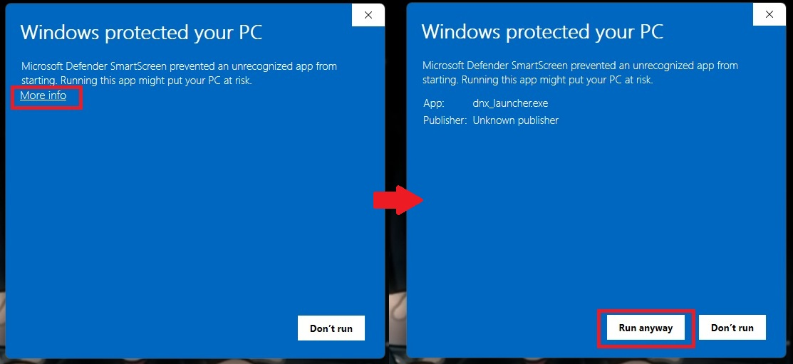
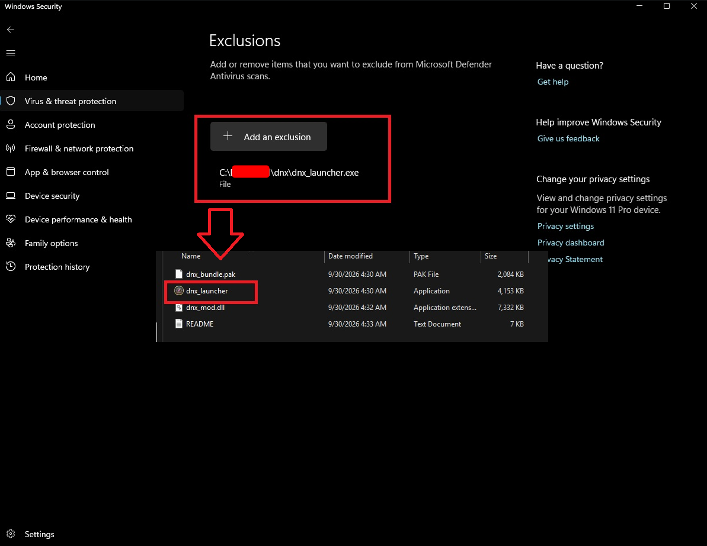

# DNX-Public

Public repo for DNX Dragon Nest Mod.

DNX adds an in-game overlay to Dragon Nest with quality-of-life and graphics options, a damage meter, chat
filters, automation helpers and a quick-login helper. It starts through its own launcher; the game files are not
modified. It works on the North America and Southeast Asia clients.

## Install

1. Download the latest `DNXv<version>.zip` from [Releases](../../releases).
2. Extract the `dnx` folder anywhere you like, for example `C:\dnx`. Do not put it inside the game folder.
3. Make sure the game is up to date (start it once with the official launcher if a patch came out).
4. Run `dnx_launcher.exe`. On first start, pick your server and the Dragon Nest folder (the one with
   `DragonNest_x64.exe`).
5. Press `/` in game to open the overlay.

The launcher updates itself, the mod and its data from the latest release every time it starts.

### "Windows protected your PC" / antivirus warnings

DNX is a small, unsigned hobby project, and the launcher loads the mod into the game process. Browsers, Windows
SmartScreen and antivirus programs may warn about or block `dnx_launcher.exe` or `dnx_mod.dll`. This is a false
positive.

Only do the steps below for a copy downloaded from this repo's [Releases](../../releases) page.

**Browser** ("isn't commonly downloaded"): open the download list and choose Keep (Edge: `...` > Keep > Show more >
Keep anyway; Chrome: Keep / Download dangerous file).

**SmartScreen** ("Windows protected your PC"): click "More info", then "Run anyway".

**Microsoft Defender:** add `dnx_launcher.exe` as an exclusion so Defender stops blocking it.

1. Open Windows Security > Virus & threat protection.
2. Under "Virus & threat protection settings", click "Manage settings".
3. Under "Exclusions", click "Add or remove exclusions".
4. Click "Add an exclusion" > File, and pick `dnx_launcher.exe` in your `dnx` folder.

If Defender already removed a file, restore it first: Windows Security > Virus & threat protection > Protection
history > the entry > Actions > Allow / Restore. For another antivirus, add the same exclusion in its settings.

## Features

The overlay opens on Help & About. Options marked *experimental* are off by default.

### QoL
- Camera: zoom limits, field of view (30 to 100 degrees) with a Keep horizon option, tilt limit
- Camera effects: camera shake, radial blur (Stock / Reduced / Off), skill camera movement, skill motion blur
- Free camera: press a key to fly the camera away from your character, with adjustable fly and turn speed
- Controls: turn off double-tap tumble (use Shift+direction instead)
- Fast looting, including stages where you pick up items without a pet
- Shorter pet leash
- Auto-skip cutscenes and skip the intro video
- Instant craft at the blacksmith
- Skip the Board Game animation
- Hide the Beginner Guide
- Damage numbers shown as their type (CRIT, BURN, POISON, ...)
- Faster loading: Faster startup (skips the animation-file check when nothing changed) and a texture cache
- Lower memory use (*experimental*)

### Chat
- Hide the chat window, set its width
- Profanity filter, timestamps with date and time format, damage contribution and courier bird messages
- System messages only in the System tab, with exception presets
- Loot message filters for solo and party play, by grade or by item list

### Graphics
- Shader quality: Stock, Optimized or Low
- Resolution: render scale from 50% to 200% (supersampling above 100%, AMD FSR 1 below), sharpening, 4x / 8x /
  16x texture filtering
- Post-processing: SMAA or sharper FXAA, Dual Kawase bloom with strength and quality, bokeh depth of field
- Scene colors: ambient occlusion, color LUTs (built-in looks, your own LUT files, and Protanopia, Deuteranopia
  and Tritanopia colorblind modes), color style presets, film grain, chromatic aberration, vignette, deband, fog,
  character style (Anime / Adventure) and outlines (fog, character style and outlines are *experimental*)
- Shadows: shadow distance, skip small distant shadows
- Effects: particle density, hide particles by type, keep drop effects for good items, skill-effect opacity for
  you and for other players
- Clutter: hide your own or other players' pets
- View distance
- Frame pacing: frame rate cap, lower FPS in the background, frame latency
- Stream view: a second "DNX Stream View" window that shows the game without the overlay, damage meter or timer,
  for OBS Window Capture or Discord window share

### HUD
- Damage meter with Boss / Dungeon, Nest and DPS chart tabs, several styles, compact mode, movable position and a
  show/hide key
- DPS chart modes: 5s rolling DPS, 1s DPS, average DPS and party total, with a choice of players on the chart
- FPS / ping readout in the game's own text, visible with the overlay closed
- Countdown / stopwatch widget
- Static class icon portrait in place of the animated face

### Automation
- Follow a party leader or member
- Selection Pouch auto opener: pick a pouch and reward, set how many to open (bag and cash inventory)
- Skill Jade auto-unseal for sealed +0 jades

### Login
- Quick Login: save accounts and fill in the login boxes with one click on the login screen.
  In windowed mode the automatic 2nd-password step is flaky and can crash the game; play fullscreen or
  untick "Auto-continue past login". Saved logins are scrambled, not strongly encrypted; do not save accounts on a
  shared computer.

### Launcher
- Setup window for server (North America / Southeast Asia) and install folder; hold Shift at start to
  reopen it
- Checks the game is up to date before launching
- Updates itself (launcher, mod and data) from the latest release on every start; turn off with
  `--no-update` or `"launcher": {"update": {"enabled": false}}` in `config.json`
- Run multiple clients: each game you start gets its own instance and configuration (on by default)
- All settings in one `config.json` next to the launcher

### Help & About
- Rebindable overlay key
- Hook status page
- Performance recording for stutter / FPS bug reports
- Support development link

## Reporting a bug

Logs are in the `dnx` folder:

- `logs\session\` holds one log per launch, named by date and time. Attach the newest one.
- `logs\crash\` holds a crash report if the game crashed, or a freeze report if it hung for 10 seconds or more.
  Attach it too if there is one.

Describe what you did and what went wrong. For stutter or FPS problems, use Performance recording on the Help &
About page.

## Troubleshooting

- **"Your game client is out of date":** update the game with the official launcher, then run `dnx_launcher.exe`
  again.
- **Launcher does nothing:** hold Shift while starting it and check that the install folder points at the folder
  with `DragonNest_x64.exe`.
- **No overlay in game:** press `/` and check the hook status on Help & About.
- **Reset all settings:** close the game and delete `config.json`. Saved logins in `dnx_login.dat` are kept.

## Uninstall

Delete the `dnx` folder. The game was not changed and keeps working with the official launcher.

## Disclaimer

DNX is an unofficial fan project, not affiliated with or endorsed by the publishers of Dragon Nest.
Using third-party tools may break the game's terms of service; use it at your own risk.
